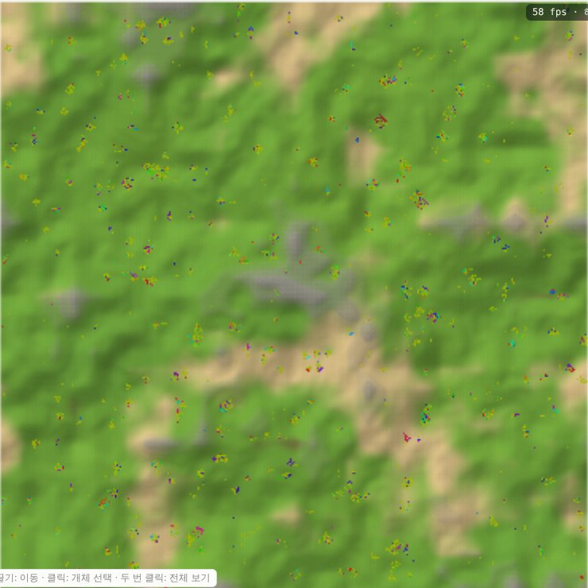
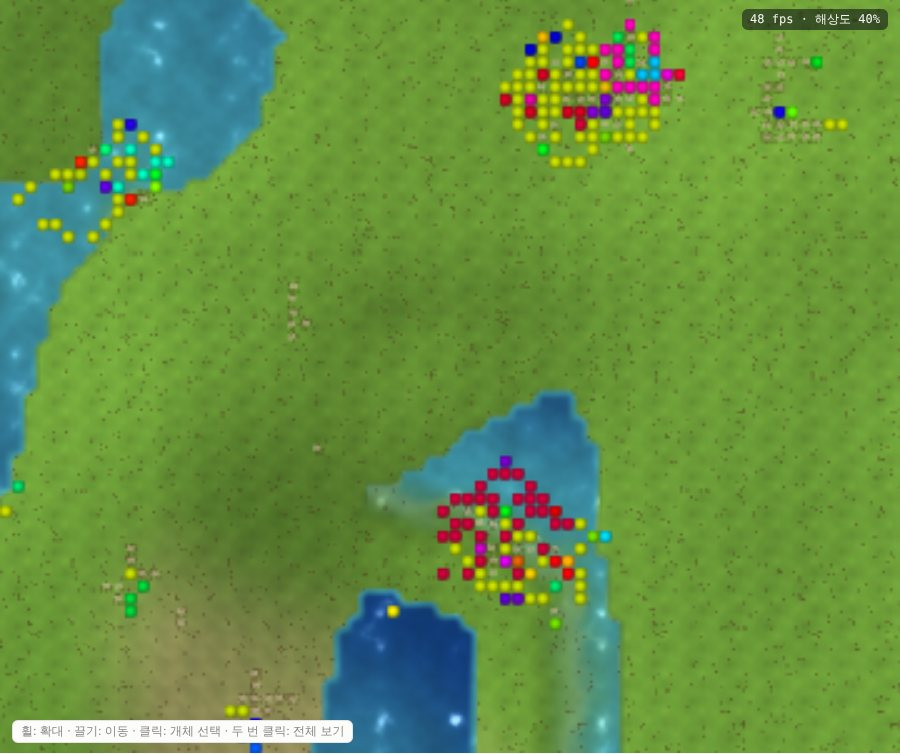
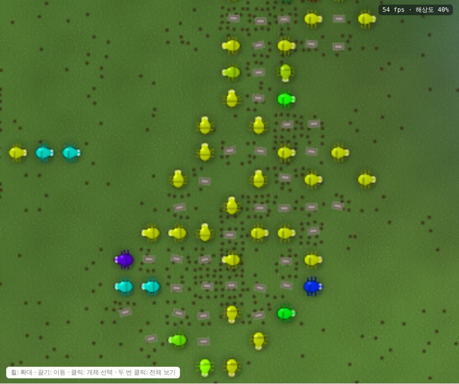

# Gene

인공문명 진화 시뮬레이터다. 원본 설계의 기본 제품(M0 물리·생명과 M1 정보·구조물·접촉)을 구현했다. 공개된 최소 조상 하나에서 시작해, 정해진 물리 규칙만으로 생존·번식·변이와 그 너머가 일어나는지 관찰한다. 문명, 직업, 기술은 엔진에 넣지 않는다. 그런 것이 생기는지는 실행 결과로 판정한다.

- 현행 규칙: [`docs/SPEC.md`](docs/SPEC.md). 유일한 기준 문서다.
- 원본 설계서 R10: [`docs/archive/R10-original-design.md`](docs/archive/R10-original-design.md). 보관용 근거 자료다.
- 실험 결과: [`docs/results/`](docs/results/)

## 상태

| 항목 | 상태 |
| --- | --- |
| 엔진(`gene-core`) | M0와 M1(M1a..M1f) 구현 완료 |
| 관찰층 | 행동 family와 사용 상태, 관계 graph·집단·영토, 반복 구조물, 복사 계보와 전달 증거(원본 §58, §29). 세계에는 영향 없음 |
| 시험 | 128개 통과 (단위 43, 장부·결정론·병렬 5, VM·이동 10, M1a/b 9, parcel 6, 결합·조립체 15, 접촉 15, parcel 매체 10, 복사 계보 1, 새 물리판 8, 여러 조상 2, 흙의 물 2, 조상 크기 1, CLI 1) |
| 에너지·원자 장부 | 시험에서는 매 tick 정확히 일치, 실행 중에는 4096 tick마다 검사 |
| 결정론 | 같은 seed면 같은 hash. 저장 후 이어 간 결과도 같음 |
| E1-a: Founder-4(원본 §57) | 20/20 seed가 첫 밤에 전멸 |
| E1-b: Founder-5(개정판) | 20/20 seed가 49일 생존. 그러나 계속 줄어 마지막 개체 수 중앙값 66 ([`docs/results/E1.md`](docs/results/E1.md)) |
| E1-c: Founder-6(오전에만 번식) | 20/20 seed가 49일 생존. 9일째 약 5,300까지 늘었다가 감소(마지막 중앙값 663). 원인은 신생아 사망: 물과 탄소가 죽은 유기물에 갇혀 39일째 땅의 81%에 물이 없음 |
| E1-d: Founder-7(죽은 G 수거) | 진행 중. 중간까지 같은 날 Founder-6의 약 3배. 다음 함정은 죽은 개체의 코드 기록 |
| E2 조상: Founder-8(신호), -9(기록 학습), -10(구조물) | Founder-7에 습관 하나씩. 소규모 4 seed에서 셋 다 혼자 살아남음. `--founder founder8+founder9+founder10`으로 한 세계에 섞음 (SPEC §16e) |
| P1: M1 기능의 자연 발견 | 소규모 4 seed에서 없음. m0와 m1d 결과가 완전히 같음 ([`docs/results/P1_M1_pilot.md`](docs/results/P1_M1_pilot.md)) |
| 속도(512², 개체 약 1,700) | 약 190 TPS, 단일 thread. 명세 목표 S1(500+) 미달, 병목은 환경 수송. Think·수송·환경은 `--sim-threads N`으로 병렬(결과 동일) |
| M1a(신호·공개 기록·초안) | ruleset `gene-m1-1`(`--ruleset m1a`) |
| M1b(학습 채택) | ruleset `gene-m1-2`(`--ruleset m1b`): DraftCommit, learned binding, 실행 중 옛 코드 보존 |
| M1c(구조물 parcel) | ruleset `gene-m1-3`(`--ruleset m1c`): 짓기·압축·내부 저장·차폐·통행 차단·내부 화학 |
| M1d(결합·조립체) | ruleset `gene-m1-4`(`--ruleset m1d`): LINK/UNLINK 면 결합·고정·grip, 최대 유량 하중 검사, 16칸까지 조립체 평행 이동·회전, 밀기 |
| M1e(개체 접촉) | ruleset `gene-m1-5`(`--ruleset m1e`): 외피가 0인 개체의 inventory 인출, 외피·몸체 마모(실제 일, 몸체 8 미만이면 사망), 개체 밀기(PushActor) |
| M1f(parcel 매체) | ruleset `gene-m1-6`(`--ruleset m1f`): parcel에 붙는 기록 매체(공개 selector 0, 8페이지). 조립체와 같이 움직이고, parcel이 부서지면 버려진 기록으로 남음. **M1 전체** |
| 새 물리판 | `gene-m0-2`(`--ruleset m0b`): 생존 온도에서 분해가 빠름(Rx2 1 → 16), 처리 순서를 가까운 칸끼리(약 10~15% 빠름). `gene-m2-1`(`--ruleset m2`): 여기에 M1 전체 + 수동 신호 전도 + LocalTrace(tile에 남는 최근 동작 흔적). SPEC §20h |
| 화면 | `gene serve`: 브라우저용 로컬 viewer. WebGL2로 그리며 60 FPS를 목표로 한다(지형 bake, 개체 point sprite, 해상도 자동 조절). 절차적 텍스처(풀·마른 땅·바위·젖은 흙, 물이 다 떨어진 땅은 바랜 흙색), 물결, 낮·밤, 생물 모양 개체와 보간 이동. 재생·속도·되감기(하루마다 저장점)와 되감기 전 시점까지 다시 보기·미니맵·개체 따라가기·마우스 정보·키보드(WASD, Q/E, F, 0)·색 기준(genome·계통·집단·에너지·세대)·개체 상세(최근 행동 포함)·genome 순위·탄소 그래프·새 행동 목록·집단 목록·영토(방문·물질·구조물 heatmap)·반복되는 구조물(13칸 썸네일)·기록이 새겨진 구조물·고수준 행동 후보 검토(예시 개체 따라가기, ✓/✗ 기록) |

진행 상황, 완성률, 결정이 필요한 것: [`docs/NEXT.md`](docs/NEXT.md)



| 군집 | 가까이 |
| --- | --- |
|  |  |

## 빠른 시작

Rust 1.85 이상이 필요하다.

```sh
cargo test --release                      # 전체 시험
cargo build --release

# 작은 세계에서 한 번 실행
./target/release/gene run --founder founder7 --size 128 --agents 64 --ticks 40000 --save-final --out runs/demo

# 명세 기본값(512², 1000 개체)으로 seed 여러 개를 병렬 실행
./target/release/gene batch --seeds 1-20 --threads 4 --founder founder7 --ticks 200000 --out runs/E1d

# 브라우저 화면: http://127.0.0.1:8080/ 를 연다 (처음엔 일시정지 상태)
./target/release/gene serve --founder founder7 --size 256 --agents 300
./target/release/gene serve --load runs/demo/final.bin --founder founder7   # 저장 상태 이어 보기
./target/release/gene serve --ruleset m1f --founder my.asm               # M1 기능 전체로

# 조상 프로그램 어셈블·역어셈블
./target/release/gene asm assets/founder7.asm
./target/release/gene founders

# 결과 요약
python3 scripts/e1_summary.py runs/E1d
python3 scripts/e1_newborns.py runs/E1d   # 신생아 생존
```

`--founder`에는 `founder4`..`founder10` 또는 어셈블리 파일 경로를 줄 수 있고, `+`로 이어 여러 조상을 한 세계에 둘 수 있다(조상 i는 i mod n번째 프로그램). `--ruleset`은 `m0`(기본), `m1a`..`m1f`, `m0b`, `m2`다. `m2`가 지금 있는 모든 기능이다(SPEC §20h). 실행마다 다음 파일이 생긴다.

| 파일 | 내용 |
| --- | --- |
| `stats.csv` | 256 tick마다 개체 수, 출생·사망, 에너지 수지(유지·VM·효과), 광합성·호흡, 고유 genome 수, 장부 잔차 |
| `births.csv` | 출생 사건: 부모, 세대, genome hash, 변이 종류 |
| `deaths.csv` | 사망 사건: 원인, 나이, 자식 수 |
| `map_*.png` | 지형(고도·물)과 개체(genome별 색) |
| `summary.json` | 설정, 결과, 상태 hash, 속도, 효과 결과별 횟수, M1 계수, 행동 family 요약 |
| `genomes.txt` | 마지막 시점의 많은 genome과 founder 대비 차이 |
| `behaviors.csv` | 반복되는 행동 family(원본 §58 A1.4): 처음 나타난 tick, 개체 수, 대표 효과 순서 |
| `judge.csv` | 반복 family마다 고수준 판정의 거르기(SPEC §17f B): 성공률, 성과 비, 조상 유형 수, 조상 code 창 수, 통과 |
| `highlevel.csv` | 반복 family가 이어진 연쇄(SPEC §17f C): 판정(pass 또는 걸린 규칙), 새로움, 개체 수, 하루 중 때, 결과물, 단계별 행동 |
| `groups.csv` | 4096 tick 창마다 관계 graph의 집단(원본 §29): 개체 수, 관계 종류, 지속 창 수, 문명 후보 여부 |
| `artifacts.csv` | 두 곳 이상에서 나타난 구조물 모양(원본 §58): 독립 occurrence 수, 만든 개체 수, 반복 확정 tick |
| `lineage.csv` | 다른 개체가 쓴 코드가 기록을 거쳐 채택·출생으로 들어와 실행된 사건(원본 §58 전달 증거): 저자, kin/non-kin, cell 수 |

## 구조

```
crates/gene-core   시뮬레이션 core (Bevy·관찰기에 의존하지 않음)
  rng.rs           Philox4x32-10 + BLAKE3 stream 주소, 확률적 정수화 SR
  world.rs         지형 생성 WorldGen-3, tile 상태
  species.rs       10종 물질, 원소, 반응 Rx0..Rx8
  vm.rs, isa.rs    레지스터 VM, 어셈블러
  effects.rs       TRANSFER·WRITE·WORK·COPY·LINK (stage 4)
  records.rs       신호·공개 기록·초안·학습 채택 (M1a, M1b)
  parcels.rs       구조물 parcel: WORK, pore 교환, 내부 화학 (M1c)
  bonds.rs         결합·grip, 하중 graph, 조립체 이동 (M1d, stage 5)
  contact.rs       개체 마모, PushActor (M1e)
  traces.rs        LocalTrace: tile에 남는 최근 외부 동작 4개 (gene-m2-1)
  behavior.rs      행동 token·sketch·family (관찰 전용, 원본 §58)
  relations.rs     관계 graph, 결정론적 LPA 집단 탐지와 ID 유지 (관찰 전용, 원본 §29)
  artifacts.rs     구조물 모양 hash, 독립 occurrence, 반복 구조물 (관찰 전용, 원본 §58)
  lineage.rs       기록의 cell 구간별 출처, 복사·채택·실행으로 확인한 전달 (관찰 전용, 원본 §58)
  repro.rs         배아 상태 기계
  mutation.rs      point·구조 변이 8종
  motion.rs        동시 이동 의존 graph (stage 6)
  env.rs           빛·외기·수송·화학 (stage 7–8)
  sim.rs           tick 순서, 장부, 저장·이어하기
crates/gene-cli    실행기 `gene` (run, batch, resume, serve, inspect, asm)
  serve.rs         로컬 viewer 서버 (std만 사용, 시뮬레이션 thread가 상태를 단독 소유)
assets/            공개 조상 founder4..7.asm, viewer.html
scripts/           결과 집계
docs/              명세, 결과, 원본 보관본
```

## 원칙

- **몰래 돕지 않는다.** 보너스, 숨은 행동, 관찰 결과의 피드백이 없다. 조상 프로그램은 공개된 시작 조건이다.
- **규칙을 바꾸면 ruleset 번호를 올린다.** 결과를 이전 실행과 섞지 않는다.
- **새 물리는 증거가 있을 때만 넣는다.** 실행에서 그것이 없어서 막힌 경로가 관찰되어야 한다([`docs/SPEC.md` §21](docs/SPEC.md)).
- 구현 완료, 물리적 가능성, 자연 발견은 서로 다른 주장이다.
