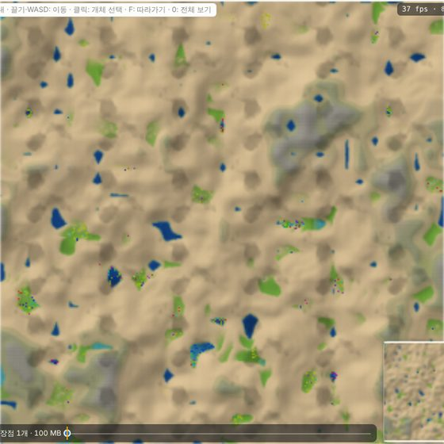

# E1: 조상 생존 실험

SPEC §18의 사전 고정 조건으로 공개 조상 세 가지를 차례로 시험했다. 각 판은 앞 판의 결과를 보고 시작 조건(조상 genome)만 바꿨다. 물리 규칙은 모두 `gene-m0-1`이다.

| 실험 | 조상 | 결과 | 다음 행동 |
| --- | --- | --- | --- |
| E1-a | Founder-4 (원본 §57) | 20/20 seed가 첫 밤에 전멸 | 에너지 수지 분해 → Founder-5 |
| E1-b | Founder-5 (§16b) | 20/20 seed가 49일 생존, 그러나 계속 감소 | 신생아 생존 분해 → Founder-6 |
| E1-c | Founder-6 (§16c) | 20/20 seed가 49일 생존. 9일째 최대 약 5,300까지 늘었다가 감소, 마지막 중앙값 663 | 탄소 수지 분해 → Founder-7 |
| E1-d | Founder-7 (§16d) | 8/8 seed(13..20) 49일 생존. 14일째 최대 약 6,700 뒤 감소, 마지막 중앙값 2,247(Founder-6의 약 3.4배) | 마름의 원인 분해 → 흙의 물 붙잡기 후보(E1-f) |
| E1-f | Founder-7 + `gene-m0-3`(§20i) | 2/2 seed(20, 19) 49일 생존. 21일째 약 1.2만에서 멈춰 끝까지 거의 일정, 마지막 10,438, 11,185(같은 seed E1-d의 약 6배). 땅이 마르지 않음 | 결정 5 확정 대기, 나머지 seed 실행 중 |

## 프로토콜

- seed 1..20, 512×512, 개체 1000, 200,000 tick(약 49일, 하루 = 4096 tick).
- 실행 명령: `gene batch --seeds 1-20 --threads 4 --founder <founder> --ticks 200000 --map-every 32768 --out runs/<name>`
- 모든 실행에서 매 기록 주기마다 장부 감사(에너지·원자 수·열용량)를 했다. 60개 실행 모두 잔차 0이다.

**재현성.** 세 실험 모두 시뮬레이션 코어가 같은 코드에서 돌았다. commit `313e4f9`부터 `a997451`까지 `crates/gene-core`는 Founder-6 상수 한 줄 말고는 바뀌지 않았다. 그래서 고정 binary `runs/bin/gene-a997451`(commit `a997451`) 하나로 세 실험을 모두 재현할 수 있다. E1-a seed 1을 이 binary로 다시 돌린 결과는 원래 실행과 CoreHash가 같았다(`d796e028…`, 전멸 tick 3011).

이후의 버려진 기록 UID 정렬 수정(SPEC §5.1)은 M0 물리 지문을 바꾸지 않았다. 조상들은 버려진 기록을 읽거나 쓰지 않는다. 그래도 bit 단위 재현은 고정 binary로 한다.

## E1-a: Founder-4

20개 seed 모두 tick 2841..3744(중앙값 2969)에 전멸했다. 해가 진 뒤 첫 밤을 넘기지 못했다. 출생은 seed마다 51..148건이었고 모두 1세대였다.

첫 오후(tick 0..1024)의 개체·tick당 수지(q):

| 조상 | 유지 | VM | 효과 시도비 | 효과 실행량 | 지출 합 | 광합성 수입 |
| --- | --- | --- | --- | --- | --- | --- |
| Founder-4 | 44.3 | 111.4 | 15.0 | 77.0 | 247.6 | 180.2 |
| Founder-5 | 35.9 | 18.5 | 6.6 | 22.1 | 83.1 | 137.5 |

Founder-4는 낮에도 수입보다 지출이 컸다. 가장 큰 항목은 VM이다. 매 tick 우선순위 표 전체를 다시 평가하느라 tick당 약 30 명령을 썼다. 이동(약 520q/회)과 해 질 무렵 번식도 밤 비축을 깎았다. 그래서 Founder-5는 판단 루프를 줄이고 번식 조건을 엄격하게 바꿨다(SPEC §16b).

원자료: `E1/E1a_summary.md`, `E1/E1a_batch.csv`, `E1/E1a_seed001_stats.csv`

## E1-b: Founder-5

20개 seed 모두 200,000 tick을 살아남았다. 첫 출생은 모든 seed에서 tick 313이었다. 개체 수는 첫날 최대 약 1,880으로 늘었다가 이후 꾸준히 줄었다. 마지막 개체 수는 4..137(중앙값 66)이다.

새벽 시점 개체 수 중앙값(20 seed):

| 날 | 0 | 7 | 14 | 21 | 28 | 35 | 42 | 49 |
| --- | --- | --- | --- | --- | --- | --- | --- | --- |
| 개체 수 | 1000 | 267 | 196 | 160 | 134 | 103 | 96 | 70 |

감소는 49일 끝까지 멈추지 않았다. SPEC §18의 해석표로는 "출생은 있으나 감소"다. 아직 지속 개체군이라고 부를 수 없다.

| 지표 | 값 |
| --- | --- |
| 출생 | 6,616..15,489 / seed, 합 235,046 |
| 사망 원인 | 전부 energy 고갈. body 손상 사망 0 |
| 최대 세대 | 19..34 (중앙값 29) |
| 고유 genome(마지막 시점) | 4..77 |
| 자식 없이 죽은 개체 | 72..74% |
| 사망 나이 중앙값 | 약 1,900..2,000 tick (반나절) |
| 변이가 있는 출생 | 24.9% (구조 변이 3.0%) |
| TPS (512², 4 seed 동시) | 138..170 |

원자료: `E1/E1b_summary.md`, `E1/E1b_batch.csv`

### 왜 줄어드는가: 출생 시각

사망은 모두 energy 고갈이다. 신생아가 출생 뒤 하루를 넘기는지를 출생 시각별로 나누면 차이가 뚜렷하다. 출생 시각 p = (tick + 1024) mod 4096이고, 낮은 0..2048, 정오는 1024다.

| 출생 시각 | 하루 생존 | n |
| --- | --- | --- |
| 새벽 (p 0..511) | 49% | 408 |
| 오전 (512..1023) | 38% | 10,986 |
| 이른 오후 (1024..1535) | 25% | 175,509 |
| 늦은 오후 (1536..2047) | 0% | 46,662 |

출생의 95%가 오후에 몰렸다. Founder-5는 G ≥ 50을 모은 뒤에야 번식을 시작한다. 광합성으로 G를 그만큼 모으면 이미 정오가 지나 있다. 늦은 오후에 태어난 자식은 하나도 첫 밤을 넘기지 못했다. 자식에게 넘긴 energy도 부모의 밤 비축에서 나갔다.

밝은 땅이 늘 유리하지는 않았다. 가장 밝은 tile(Lpeak ≥ 57344)의 생존이 그보다 한 단계 어두운 tile보다 낮았다(seed 7: 17.5% 대 23.6%). 밝은 곳에 개체가 몰려 자리를 다투기 때문으로 보인다(`E1/E1b_survival_seeds.md`).

### 진화의 흔적

마지막 2일 동안의 출생을 계통별로 봤다(`E1/E1b_lineage.md`).

- 변이 genome 비율(founder genome이 아닌 출생)의 중앙값은 69%다. 18개 seed 중 4개에서는 가장 흔한 genome이 founder가 아니라 변이체다.
- 남은 founder 계통 수의 중앙값은 4다(시작 1000). 대부분의 계통은 사라졌다.
- seed 5와 9는 마지막 2일 동안 출생이 없었다.

변이체가 무엇을 바꿨는지는 E1-b에서는 볼 수 없다. 그때는 genome 본문을 남기지 않았다. E1-c부터는 모든 실행이 끝에 `genomes.txt`(많은 genome과 founder 대비 명령 차이)를 남긴다.

## Founder-6의 근거

E1-b의 결론은 "번식 시각"이다. 그래서 Founder-6은 번식 시작 조건 하나만 바꿨다(SPEC §16c).

| 항목 | Founder-5 | Founder-6 |
| --- | --- | --- |
| 번식 시작 시각 | 빛이 오르는 중이거나 ≥ 24576 | 빛이 오르는 중(오전)일 때만 |
| G 문턱 | ≥ 50 | ≥ 30 |
| E 문턱 | ≥ 60000 | ≥ 50000 |

작은 세계에서 먼저 점검했다(128², 개체 64, 40,000 tick, seed 1..4).

| 조상 | 마지막 개체 수 | 출생 | 전멸 |
| --- | --- | --- | --- |
| Founder-5 | 0, 4, 27, 27 | 233..488 | 1/4 |
| Founder-6 | 174..277 | 1,379..1,661 | 0/4 |

이 점검은 탐색용이며 E1-c의 결과를 대신하지 않는다.

## E1-c: Founder-6

같은 프로토콜, 고정 binary `runs/bin/gene-a997451`로 실행했다. 처음 batch가 seed 17..20을 끝낸 뒤 멈추고 seed 1..16을 다시 돌렸다. seed마다 독립이라 결과는 나눠 돌린 것과 무관하다. 20개 실행 모두 장부 감사를 통과했다.

20개 seed 모두 200,000 tick을 살아남았다. 개체 수는 9일째까지 늘어 중앙값 약 5,300이 됐다(seed별 최대 7,336..10,169). 그 뒤 49일째까지 꾸준히 줄었다.

새벽 시점 개체 수(20 seed):

| 날 | 0 | 1 | 3 | 7 | 9 | 14 | 21 | 28 | 35 | 42 | 48 |
| --- | --- | --- | --- | --- | --- | --- | --- | --- | --- | --- | --- |
| 중앙값 | 1000 | 890 | 2337 | 4712 | 5273 | 4632 | 2830 | 1814 | 1229 | 880 | 720 |
| 범위 | — | 867..911 | 2198..2597 | 3919..5286 | 4351..5971 | 3908..5303 | 2478..3465 | 1516..2265 | 1038..1523 | 707..1132 | 524..895 |

| 지표 | 값 |
| --- | --- |
| 마지막 개체 수 | 487..820 (중앙값 663). Founder-5의 약 10배 |
| 출생 | 74,378..97,273 / seed (중앙값 89,974) |
| 사망 원인 | 전부 energy 고갈 |
| 최대 세대 | 27..41 (중앙값 33) |
| 고유 genome(마지막) | 180..372. founder genome 그대로인 개체는 28..51%(중앙값 35%) |
| 자식 없이 죽은 개체 | 75..78% |
| TPS (512², 4 seed 동시) | 66..86 |

감소가 끝까지 멈추지 않았으므로 SPEC §18의 해석표로는 다시 "출생은 있으나 감소"다. 지속 개체군은 아직 아니다.

원자료: `E1/E1c_batch.csv`, 실행 디렉터리 `runs/E1c_founder6/`

### 번식 시각은 고쳐졌다

seed 1과 7에서 출생 시각별 하루 생존을 다시 봤다(`scripts/e1_survival.py`).

| 출생 시각 | E1-b 비율 | E1-c 비율 | E1-c 하루 생존 |
| --- | --- | --- | --- |
| 새벽 (p 0..511) | 0.2% | 0.0% | 26..39% |
| 오전 (512..1023) | 4.7% | 53..55% | 38..41% |
| 이른 오후 (1024..1535) | 75% | 45..47% | 8..9% |
| 늦은 오후 (1536..2047) | 20% | 0.1% | 0% |

Founder-6은 의도대로 출생을 오전으로 옮겼다. 늦은 오후 출생은 거의 사라졌다. 처음 9일의 급증은 이 변화에서 나왔다.

### 감소의 원인: 신생아가 수입 없이 죽는다

20 seed 전체의 출생을 날짜 구간으로 나눴다(`scripts/e1_newborns.py`).

| 출생 날 | 하루 생존 | 오전 출생 비율 | 개체당 하루 출생 |
| --- | --- | --- | --- |
| 0..7 | 55.2% | 66% | 0.68 |
| 7..14 | 27.6% | 54% | 0.61 |
| 14..21 | 14.6% | 48% | 0.55 |
| 21..28 | 10.2% | 48% | 0.52 |
| 28..35 | 8.1% | 49% | 0.51 |
| 35..42 | 6.9% | 52% | 0.51 |
| 42..48 | 5.9% | 50% | 0.46 |

- 출생률은 3분의 1쯤 줄었지만 신생아 생존은 9분의 1로 줄었다. 감소의 대부분은 신생아 사망이다.
- 변이 탓이 아니다. founder genome 그대로인 신생아도 똑같이 떨어졌다(처음 7일 60.2% → 35일 이후 7.6%). 변이체는 각각 47.2%, 5.9%다.
- 죽는 시점이 달라졌다. 처음 7일에 죽은 신생아는 중앙값 2,112 tick을 살았고 67%가 밤에 죽었다. 35일 이후에는 중앙값 380 tick이고 밤에 죽은 비율은 45%다. 신생아가 받는 energy(16,384q 이상)를 유지비(약 56q/tick)만으로 쓰면 약 290 tick이다. 후반 신생아는 태어난 뒤 수입이 거의 없다.

어른은 버틴다. 정오의 평균 energy는 53,000..57,000으로 거의 그대로이고, 평균 inventory G는 11에서 16으로 오히려 늘었다. 어른은 모아 둔 G를 호흡해 산다. 신생아는 G 비축이 없어서 태어난 자리에서 광합성을 해야 한다.

| 첫 새벽 → 마지막 새벽 (중앙값) | Founder-5 | Founder-6 |
| --- | --- | --- |
| 공기 중 C | 4.21M → 3.95M | 4.23M → 2.16M |
| loose G(죽은 유기물) | 0.41M → 0.60M | 0.40M → 1.88M |
| 버려진 기록 페이지 | 7,546 → 83,080 | 550 → 580,580 |
| 개체당 하루 광합성 | 178 → 175 | 185 → 159 |
| 개체당 하루 G 잉여(광합성 − 호흡) | +22 → +15 | +21 → +11 |

탄소가 죽은 유기물에 갇힌다. 생존 온도(270..329 K)에서 G 분해(Rx2)의 속도 등급은 1로, 거의 일어나지 않는다. 개체가 많아질수록 죽은 몸의 G와 버려진 기록이 쌓이고 공기의 C가 준다. 변이가 생긴 출생 때마다 변이 전 사본(약 5페이지)이 땅에 버려지는 것도 같은 역할을 한다. 공기 C가 절반이 되자 개체당 G 잉여도 절반이 됐다.

**확인 실행: 모자란 것은 C보다 물(W)이다.** seed 20을 현재 binary로 160,000 tick(39일째)까지 다시 돌렸다. stats.csv가 원래 실행과 625행 모두 같았다(같은 결과). 그 상태를 읽어 신생아가 태어나는 자리를 봤다(`examples/newborn_env.rs`, `examples/newborn_trace.rs`).

| 지표 | 값 |
| --- | --- |
| tile당 공기 C 평균 | 9.7 (처음 16) |
| 물(W)도 얼음(I)도 없는 tile | 지도의 81%. 같은 seed의 첫날은 약 11%(언덕의 물이 낮은 곳으로 흘러간 자리), 2일째 16% |
| 개체가 선 tile의 C | 신생아 3.6, 어른 3.8 |
| 개체가 선 tile에서 W = 0 | 신생아 29%, 어른 28% |
| inventory G | 신생아 2.8, 어른 33 |

다음 하루 동안 태어난 365개체의 하루 생존을 출생 tile로 나눴다.

| 출생 tile | 하루 생존 | n |
| --- | --- | --- |
| W = 0 | 0.0% | 157 |
| W 1..7 | 3.4% | 88 |
| W 8 이상 | 27.5% | 120 |
| C 1..3 / 4..7 / 8..15 | 5.9% / 11.8% / 4.8% | 68 / 255 / 42 |

- C는 생존과 관계가 없지만 W는 결정적이다. W가 0인 자리에서 태어난 신생아는 하나도 하루를 넘기지 못했다.
- 추적한 신생아는 광합성 credit이 49,804로 충분했지만(1개당 10,000) G를 하나도 만들지 못했다. G가 30 미만이라 Founder-6은 잠만 잤고, energy는 유지비로 약 300 tick 만에 바닥났다.
- 광합성(C + W → G)은 C와 W를 하나씩 G에 묶는다. 죽은 G가 거의 분해되지 않으므로 둘 다 갇힌다. 물은 낮은 곳으로 흘러 호수에 모이고, 나머지 땅의 W는 8..40으로 시작하므로 W가 먼저 바닥난다. 어른은 모아 둔 G를 호흡해 사는데, 호흡(G + O → C + W)이 바로 그 자리에 W를 되돌린다. 그래서 어른 곁에서 태어난 신생아도 운이 나쁘면 W가 0인 자리에 놓인다.

39일째 seed 20의 화면이다. 물이 없는 땅은 마른 흙색, 호수와 그 주변만 녹색이다. 개체(점)는 대부분 물가에 남아 있다.

이 결과는 Founder-7의 근거를 강화한다. 죽은 G를 먹고 호흡하면 C와 W가 공기로 돌아온다(E1-d).

**정정(2026-10-10): 땅이 마르는 주원인은 생물이 아니라 배수다.** 개체가 첫 밤에 모두 죽는 Founder-4로 256² 세계(seed 1)를 120,000 tick 돌렸다. 생물이 없는데도 땅은 똑같이 말랐다. 물의 총량은 그대로였다.

| 날 | 물도 얼음도 없는 tile (`gene-m0-1`) | 같은 값 (`gene-m0-2`) |
| --- | --- | --- |
| 4 | 23% | 23% |
| 8 | 36% | 28% |
| 16 | 54% | 38% |
| 28 | 70% | 63% |

- 원인은 두 규칙이다. 고도가 다른 이웃 사이에서는 물이 한 단위까지 모두 아래로 흐른다(§5.2). 생존 온도에는 증발이 없다(Rx7은 374 K 이상).
- 그래서 비탈은 결국 다 마르고, 물은 호수에 모여 돌아오지 않는다.
- 위의 "광합성이 W를 G에 묶는다"는 설명은 부차적이다. 생물이 있는 E1-c(39일째 81%)와 생물이 없는 세계(28일째 70%)의 차이가 생물의 몫이다.
- 대응 후보는 §20i의 흙 물 붙잡기(`gene-m0-3`)다.

`scripts/e1_carbon.py`로 다시 계산할 수 있다.

### 변이를 막는 계통

보통 출생의 24.5%가 변이를 가진다. 그런데 자식 30 이상이 모두 정확한 사본인 genome이 20개 seed 중 12개에서 나타났다(`scripts/e1_fidelity.py`). 우연히 그럴 확률은 0.75^30 ≈ 2×10⁻⁴다. Step 자리의 1 bit 변이로 다른 REPRO sub-op를 부르는 변이체는 변이가 계획된 배아를 끝내지 못하고 취소한다. 그래서 변이 없는 사본만 남는다.

가장 큰 계통(seed 20)은 2일째부터 45일째까지 288번 태어났다. seed 7, 15의 계통도 40일 넘게 이어졌다. 그러나 어느 것도 퍼지지 않았고, 마지막 2일 출생에는 하나도 없었다.

## E1-d: Founder-7

같은 프로토콜이다. seed 17..20은 `runs/bin/gene-10e6348`로, 14..16은 컨테이너 재시작 뒤 같은 binary로 다시 돌렸다. seed 13은 이어 달리기가 되는 binary로 돌렸다(`gene-m0-1` 결과가 같음). seed 1..12는 대기열에 있다. 8개 실행 모두 장부 감사를 통과했다.

새벽 시점 개체 수(seed 13..20):

| 날 | 1 | 3 | 7 | 9 | 14 | 21 | 28 | 35 | 42 | 48 |
| --- | --- | --- | --- | --- | --- | --- | --- | --- | --- | --- |
| 중앙값 | 897 | 1988 | 4271 | 5264 | 6651 | 5989 | 4752 | 3716 | 2913 | 2420 |
| 범위 | 887..905 | 1823..2194 | 3516..4833 | 4284..6056 | 5406..7285 | 4830..6302 | 3932..5031 | 3161..3940 | 2425..3274 | 1916..2809 |
| E1-c 중앙값 | 890 | 2337 | 4712 | 5273 | 4632 | 2830 | 1814 | 1229 | 880 | 720 |

| 지표 | 값 |
| --- | --- |
| 마지막 개체 수 | 1,725..2,618 (중앙값 2,247). Founder-6의 약 3.4배 |
| 최대 개체 수 | 9,789..13,526 |
| 출생 | 152,535..196,433 / seed (중앙값 186,347) |
| 최대 세대 | 32..44 (중앙값 35.5) |
| 고유 genome(마지막) | 779..1,265 |

| 첫 새벽 → 마지막 새벽 (중앙값) | Founder-6 (E1-c) | Founder-7 (E1-d) |
| --- | --- | --- |
| 공기 중 C | 4.23M → 2.16M | 4.23M → 2.85M |
| loose G(죽은 유기물) | 0.40M → 1.88M | 0.39M → 0.50M |
| 버려진 기록 페이지 | 550 → 580,580 | 505 → 1,227,563 |
| 개체당 하루 G 잉여 | +21 → +11 | +14 → +3 |

신생아 하루 생존은 처음 7일 52.9%에서 42..48일 14.4%로 떨어졌다(E1-c는 55.2% → 5.9%).

- 죽은 G를 먹는 습관은 땅의 G를 억눌렀다(188만 → 50만).
- 대신 버려진 코드 기록이 두 배로 쌓였다. 개체가 많아 죽음도 많기 때문이다.
- 그래도 감소는 멈추지 않았다. 원인의 큰 몫은 땅이 마르는 것이고, 이는 생물과 무관한 배수 문제였다(위 E1-c 정정).
- 흙이 물을 붙잡는 후보 물리(`gene-m0-3`)에서 같은 조상을 256²로 돌렸더니 24일 이후 개체 수가 거의 일정했다(2 seed). 512²에서 E1-f로 확인 중이다.

`scripts/e1_newborns.py`, `scripts/e1_carbon.py`로 다시 계산할 수 있다. 원자료는 `runs/E1d_founder7/`에 있다.

## E1-f: Founder-7 + 흙이 물을 붙잡는 후보 물리 (`gene-m0-3`)

같은 프로토콜(512², 개체 1000, 200,000 tick)이다. 물리만 `gene-m0-3`(SPEC §20i: 흙이 물 8단위를 붙잡아 비탈로 흘려보내지 않음)이다. seed 20, 19가 끝났고, 18이 실행 중이며, 17..13은 대기열에 있다. 두 실행 모두 장부 감사를 통과했다.

새벽 시점 개체 수(같은 seed의 E1-d와 비교):

| 날 | 1 | 3 | 7 | 9 | 14 | 21 | 28 | 35 | 42 | 48 |
| --- | --- | --- | --- | --- | --- | --- | --- | --- | --- | --- |
| E1-f seed 20 | 1000 | 2694 | 6380 | 8066 | 10795 | 11985 | 11990 | 11938 | 11399 | 11233 |
| E1-d seed 20 | 895 | 1823 | 3516 | 4284 | 5406 | 5072 | 4142 | 3165 | 2483 | 1916 |
| E1-f seed 19 | 1000 | 2944 | 7451 | 9261 | 11795 | 12879 | 12766 | 12609 | 12116 | 12023 |
| E1-d seed 19 | 899 | 1992 | 3966 | 4687 | 5494 | 4830 | 3932 | 3161 | 2425 | 1964 |

| 지표 | E1-f (seed 20, 19) | E1-d (같은 seed) |
| --- | --- | --- |
| 마지막 개체 수 | 10,438, 11,185 | 1,725, 1,754 |
| 최대 개체 수 | 20,251, 21,651 | 9,789, 9,812 |
| 출생 | 355,308, 386,450 | 152,942, 152,535 |
| 최대 세대 | 38, 38 | 33, 37 |
| 고유 genome(마지막) | 3,987, 4,372 | 779, 892 |
| 물도 얼음도 없는 tile(마지막) | 0 | (열 없음. E1-c 재현에서 39일째 81%) |
| 땅의 loose G(마지막) | 12.9만, 15.8만 | 47.8만, 49.7만 |

신생아 하루 생존(두 seed, `scripts/e1_newborns.py`):

| 출생 날 | E1-f | E1-d |
| --- | --- | --- |
| 0..7 | 55.2% | 52.2% |
| 14..21 | 27.8% | 25.9% |
| 28..35 | 24.0% | 19.3% |
| 42..48 | 21.5% | 14.5% |

- 개체 수가 21일째 약 1.2만에 이른 뒤 48일째까지 거의 일정했다. E1-d는 같은 기간 3분의 1로 줄었다. 땅이 마르지 않으면 Founder-7 개체군은 수용력에서 멈춘다.
- 신생아 하루 생존도 덜 떨어졌다(21.5% 대 14.5%). 남은 감소는 오후 출생의 밤 사망이다(하루 안에 죽는 신생아의 92%가 밤에 죽음).
- 출생이 2.3배, 고유 genome이 약 5배다. 개체가 많아 변이가 더 많이 시험된다.
- 결정 5(B: `gene-m0-3`)의 근거다. 256² 예비(seed 1)와 같은 결과를 512²에서 확인했다.

## 남은 질문

- E1-f: 나머지 seed(18..13)도 같은가. 지금 두 seed는 수용력에서 멈췄다(결정 5).
- M1 기능은 모두 구현되어 있다(`gene-m1-6`). SPEC §21의 진입 조건("E1에서 지속 개체군 확인")은 아직 충족되지 않았다.
